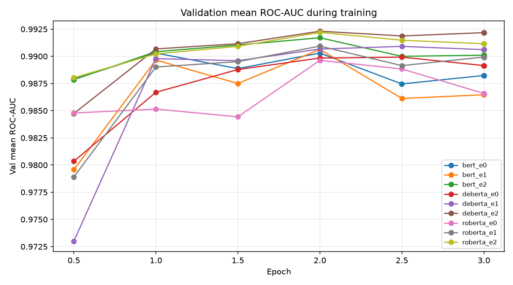

# Results

Generated by `src/evaluate.py` from `outputs/`; do not edit by hand.

Metrics follow plan §6.1; F1 uses threshold 0.5.

## 1. 主表：Jigsaw official labeled test

| Run | Model | Setting | Val mean ROC-AUC | Mean ROC-AUC | Mean PR-AUC | Macro F1 |
|---|---|---|---|---|---|---|
| tfidf_lr_e0 | tfidf_lr | e0 | 0.9859 | 0.9801 | 0.6198 | 0.5422 |
| bert_e0 | bert | e0 | 0.9903 | 0.9856 | 0.6523 | 0.5853 |
| bert_e1 | bert | e1 | 0.9907 | 0.9863 | 0.6684 | 0.5999 |
| bert_e2 | bert | e2 | 0.9917 | 0.9864 | 0.6852 | 0.6263 |
| roberta_e0 | roberta | e0 | 0.9897 | 0.9843 | 0.6618 | 0.6073 |
| roberta_e1 | roberta | e1 | 0.9909 | 0.9854 | 0.6295 | 0.5873 |
| roberta_e2 | roberta | e2 | 0.9922 | 0.9861 | 0.6718 | 0.6154 |
| deberta_e0 | deberta | e0 | 0.9899 | 0.9844 | 0.6561 | 0.5963 |
| deberta_e1 | deberta | e1 | 0.9909 | 0.9849 | 0.6461 | 0.5937 |
| deberta_e2 | deberta | e2 | 0.9923 | 0.9862 | 0.6638 | 0.5942 |
| *Rahman et al. (2023)* | baseline 參考：傳統 ML | — | — | 0.973 | — | — |
| *Mazari et al. (2024)* | SOTA 參考：BERT + Bi-LSTM/Bi-GRU ensemble | — | — | 0.9863 | — | — |
| *Kaggle 第一名* | private leaderboard，4,539 隊 | — | — | 0.98856 | — | — |

斜體列是參考值（plan §6.5），評估設定和本專案不同，只作為範圍參考，不是同一基準下的排名：Rahman 用自己的切分；Mazari 在官方 labeled test（63,977 列）上評估，但 ensemble 權重依 test 表現設定；Kaggle private leaderboard 用的是官方 test 中的 private 部分，本表的 test 是全部已標註的列。Precision、Recall、MCC、Micro F1、Hamming loss、accuracy 和文獻的比較見第 9 節。

## 2. Per-label：Jigsaw official labeled test

**ROC-AUC**

| Run | toxic | severe_toxic | obscene | threat | insult | identity_hate |
|---|---|---|---|---|---|---|
| tfidf_lr_e0 | 0.9657 | 0.9845 | 0.9786 | 0.9930 | 0.9725 | 0.9862 |
| bert_e0 | 0.9734 | 0.9896 | 0.9807 | 0.9961 | 0.9810 | 0.9927 |
| bert_e1 | 0.9763 | 0.9900 | 0.9823 | 0.9961 | 0.9807 | 0.9921 |
| bert_e2 | 0.9743 | 0.9901 | 0.9825 | 0.9971 | 0.9814 | 0.9929 |
| roberta_e0 | 0.9733 | 0.9881 | 0.9819 | 0.9907 | 0.9805 | 0.9910 |
| roberta_e1 | 0.9750 | 0.9887 | 0.9816 | 0.9958 | 0.9805 | 0.9909 |
| roberta_e2 | 0.9738 | 0.9888 | 0.9826 | 0.9979 | 0.9811 | 0.9925 |
| deberta_e0 | 0.9737 | 0.9903 | 0.9826 | 0.9876 | 0.9820 | 0.9901 |
| deberta_e1 | 0.9749 | 0.9907 | 0.9819 | 0.9924 | 0.9807 | 0.9887 |
| deberta_e2 | 0.9752 | 0.9900 | 0.9820 | 0.9963 | 0.9823 | 0.9915 |

**PR-AUC**

| Run | toxic | severe_toxic | obscene | threat | insult | identity_hate |
|---|---|---|---|---|---|---|
| tfidf_lr_e0 | 0.7853 | 0.3144 | 0.8010 | 0.4981 | 0.7360 | 0.5839 |
| bert_e0 | 0.8095 | 0.3531 | 0.7886 | 0.4981 | 0.7819 | 0.6825 |
| bert_e1 | 0.8243 | 0.3453 | 0.8106 | 0.5860 | 0.7586 | 0.6857 |
| bert_e2 | 0.8075 | 0.3537 | 0.8116 | 0.6329 | 0.7915 | 0.7139 |
| roberta_e0 | 0.8050 | 0.2809 | 0.8053 | 0.6339 | 0.7773 | 0.6684 |
| roberta_e1 | 0.8200 | 0.2842 | 0.8036 | 0.5127 | 0.7637 | 0.5928 |
| roberta_e2 | 0.8035 | 0.3003 | 0.8131 | 0.6489 | 0.7856 | 0.6795 |
| deberta_e0 | 0.8077 | 0.3467 | 0.8118 | 0.5146 | 0.7925 | 0.6635 |
| deberta_e1 | 0.8171 | 0.3776 | 0.8118 | 0.4939 | 0.7575 | 0.6184 |
| deberta_e2 | 0.8108 | 0.3179 | 0.8107 | 0.6117 | 0.7922 | 0.6394 |

## 3. Δ 表（Jigsaw test；主實驗 runs：ratio 1、seed 42）

**bert**

| Δ ROC-AUC | Mean | toxic | severe_toxic | obscene | threat | insult | identity_hate |
|---|---|---|---|---|---|---|---|
| E1 − E0（hard augmentation） | +0.0007 | +0.0029 | +0.0004 | +0.0016 | +0.0000 | -0.0002 | -0.0005 |
| E2 − E0（soft augmentation） | +0.0008 | +0.0008 | +0.0006 | +0.0018 | +0.0010 | +0.0004 | +0.0002 |
| E2 − E1（soft vs. hard） | +0.0001 | -0.0021 | +0.0001 | +0.0002 | +0.0010 | +0.0007 | +0.0007 |

| Δ PR-AUC | Mean | toxic | severe_toxic | obscene | threat | insult | identity_hate |
|---|---|---|---|---|---|---|---|
| E1 − E0（hard augmentation） | +0.0161 | +0.0147 | -0.0078 | +0.0221 | +0.0879 | -0.0232 | +0.0032 |
| E2 − E0（soft augmentation） | +0.0329 | -0.0020 | +0.0006 | +0.0231 | +0.1348 | +0.0097 | +0.0314 |
| E2 − E1（soft vs. hard） | +0.0168 | -0.0168 | +0.0084 | +0.0010 | +0.0469 | +0.0329 | +0.0282 |

**roberta**

| Δ ROC-AUC | Mean | toxic | severe_toxic | obscene | threat | insult | identity_hate |
|---|---|---|---|---|---|---|---|
| E1 − E0（hard augmentation） | +0.0011 | +0.0017 | +0.0005 | -0.0004 | +0.0051 | +0.0000 | -0.0001 |
| E2 − E0（soft augmentation） | +0.0019 | +0.0005 | +0.0007 | +0.0007 | +0.0072 | +0.0006 | +0.0015 |
| E2 − E1（soft vs. hard） | +0.0007 | -0.0011 | +0.0002 | +0.0010 | +0.0021 | +0.0006 | +0.0016 |

| Δ PR-AUC | Mean | toxic | severe_toxic | obscene | threat | insult | identity_hate |
|---|---|---|---|---|---|---|---|
| E1 − E0（hard augmentation） | -0.0323 | +0.0149 | +0.0033 | -0.0017 | -0.1211 | -0.0136 | -0.0755 |
| E2 − E0（soft augmentation） | +0.0100 | -0.0015 | +0.0194 | +0.0077 | +0.0150 | +0.0083 | +0.0111 |
| E2 − E1（soft vs. hard） | +0.0423 | -0.0164 | +0.0161 | +0.0095 | +0.1362 | +0.0218 | +0.0866 |

**deberta**

| Δ ROC-AUC | Mean | toxic | severe_toxic | obscene | threat | insult | identity_hate |
|---|---|---|---|---|---|---|---|
| E1 − E0（hard augmentation） | +0.0005 | +0.0013 | +0.0005 | -0.0007 | +0.0048 | -0.0013 | -0.0014 |
| E2 − E0（soft augmentation） | +0.0018 | +0.0015 | -0.0003 | -0.0006 | +0.0087 | +0.0003 | +0.0014 |
| E2 − E1（soft vs. hard） | +0.0013 | +0.0003 | -0.0008 | +0.0001 | +0.0038 | +0.0016 | +0.0028 |

| Δ PR-AUC | Mean | toxic | severe_toxic | obscene | threat | insult | identity_hate |
|---|---|---|---|---|---|---|---|
| E1 − E0（hard augmentation） | -0.0101 | +0.0094 | +0.0310 | -0.0000 | -0.0206 | -0.0350 | -0.0451 |
| E2 − E0（soft augmentation） | +0.0077 | +0.0031 | -0.0287 | -0.0011 | +0.0972 | -0.0003 | -0.0241 |
| E2 − E1（soft vs. hard） | +0.0177 | -0.0063 | -0.0597 | -0.0011 | +0.1178 | +0.0347 | +0.0210 |

## 4. Cross-dataset：Civil test（五類）

| Run | Mean ROC-AUC | Mean PR-AUC | Macro F1 |
|---|---|---|---|
| tfidf_lr_e0 | 0.8937 | 0.2896 | 0.1588 |
| bert_e0 | 0.9439 | 0.4045 | 0.3306 |
| bert_e1 | 0.9721 | 0.5769 | 0.5539 |
| bert_e2 | 0.9797 | 0.5890 | 0.4979 |
| roberta_e0 | 0.9274 | 0.3924 | 0.2998 |
| roberta_e1 | 0.9738 | 0.5715 | 0.5544 |
| roberta_e2 | 0.9813 | 0.5834 | 0.5194 |
| deberta_e0 | 0.9312 | 0.3983 | 0.3534 |
| deberta_e1 | 0.9709 | 0.5974 | 0.5840 |
| deberta_e2 | 0.9814 | 0.6026 | 0.5512 |

**ROC-AUC**

| Run | toxic | obscene | threat | insult | identity_hate |
|---|---|---|---|---|---|
| tfidf_lr_e0 | 0.8666 | 0.9191 | 0.9008 | 0.8608 | 0.9212 |
| bert_e0 | 0.9249 | 0.9684 | 0.9442 | 0.9342 | 0.9481 |
| bert_e1 | 0.9613 | 0.9862 | 0.9646 | 0.9702 | 0.9780 |
| bert_e2 | 0.9649 | 0.9886 | 0.9871 | 0.9731 | 0.9850 |
| roberta_e0 | 0.9286 | 0.9487 | 0.8787 | 0.9419 | 0.9389 |
| roberta_e1 | 0.9620 | 0.9822 | 0.9731 | 0.9703 | 0.9814 |
| roberta_e2 | 0.9659 | 0.9907 | 0.9891 | 0.9737 | 0.9874 |
| deberta_e0 | 0.9352 | 0.9624 | 0.9014 | 0.9472 | 0.9097 |
| deberta_e1 | 0.9626 | 0.9820 | 0.9620 | 0.9702 | 0.9780 |
| deberta_e2 | 0.9679 | 0.9899 | 0.9866 | 0.9753 | 0.9872 |

**PR-AUC**

| Run | toxic | obscene | threat | insult | identity_hate |
|---|---|---|---|---|---|
| tfidf_lr_e0 | 0.4983 | 0.2400 | 0.1047 | 0.4510 | 0.1540 |
| bert_e0 | 0.5971 | 0.3554 | 0.2519 | 0.5989 | 0.2190 |
| bert_e1 | 0.7542 | 0.5914 | 0.3682 | 0.7640 | 0.4065 |
| bert_e2 | 0.7488 | 0.5755 | 0.4244 | 0.7757 | 0.4206 |
| roberta_e0 | 0.6071 | 0.3238 | 0.2149 | 0.6274 | 0.1890 |
| roberta_e1 | 0.7528 | 0.5805 | 0.3607 | 0.7645 | 0.3991 |
| roberta_e2 | 0.7471 | 0.5524 | 0.4303 | 0.7668 | 0.4206 |
| deberta_e0 | 0.6037 | 0.3435 | 0.2401 | 0.6446 | 0.1593 |
| deberta_e1 | 0.7663 | 0.5962 | 0.4212 | 0.7647 | 0.4385 |
| deberta_e2 | 0.7593 | 0.5750 | 0.4696 | 0.7789 | 0.4301 |

## 5. 錯誤分析：deberta（Jigsaw test，threshold 0.5）

| Setting | toxic FP / FN | severe_toxic FP / FN | obscene FP / FN | threat FP / FN | insult FP / FN | identity_hate FP / FN |
|---|---|---|---|---|---|---|
| e0 | 5,628 / 400 | 283 / 210 | 2,552 / 474 | 207 / 56 | 1,657 / 668 | 510 / 175 |
| e1 | 5,315 / 399 | 587 / 117 | 2,032 / 628 | 266 / 46 | 2,060 / 603 | 504 / 203 |
| e2 | 4,934 / 407 | 625 / 127 | 2,093 / 643 | 326 / 25 | 2,306 / 460 | 521 / 173 |

**E0 → E2 預測翻轉**

| Flip | toxic | severe_toxic | obscene | threat | insult | identity_hate |
|---|---|---|---|---|---|---|
| FN → TP | 127 | 83 | 61 | 34 | 259 | 48 |
| TP → FN | 134 | 0 | 230 | 3 | 51 | 46 |
| TN → FP | 557 | 351 | 198 | 168 | 875 | 158 |
| FP → TN | 1,251 | 9 | 657 | 49 | 226 | 147 |

E0 false negatives（每類最多 20 筆，seed 42；實際 threat 20 筆、identity_hate 20 筆）已存到 `error_samples_deberta.csv`，供人工閱讀。

## 6. 訓練曲線

## 7. Bootstrap 95% CI：Δ ROC-AUC（Jigsaw test，paired，1,000 次，seed 42）

格式：點估計 [2.5%, 97.5%]；`*` 表示 CI 不含 0。只反映測試資料的抽樣誤差，不含訓練隨機性（單一 seed）。

**bert**

| Δ ROC-AUC | Mean | toxic | severe_toxic | obscene | threat | insult | identity_hate |
|---|---|---|---|---|---|---|---|
| E1 − E0（hard augmentation） | +0.0007 [+0.0002, +0.0011] * | +0.0029 [+0.0023, +0.0036] * | +0.0004 [-0.0002, +0.0012] | +0.0016 [+0.0011, +0.0022] * | +0.0000 [-0.0017, +0.0013] | -0.0002 [-0.0011, +0.0006] | -0.0005 [-0.0018, +0.0006] |
| E2 − E0（soft augmentation） | +0.0008 [+0.0004, +0.0012] * | +0.0008 [+0.0002, +0.0015] * | +0.0006 [-0.0002, +0.0013] | +0.0018 [+0.0013, +0.0024] * | +0.0010 [+0.0001, +0.0020] * | +0.0004 [-0.0005, +0.0013] | +0.0002 [-0.0009, +0.0015] |
| E2 − E1（soft vs. hard） | +0.0001 [-0.0002, +0.0004] | -0.0021 [-0.0025, -0.0016] * | +0.0001 [-0.0002, +0.0005] | +0.0002 [-0.0002, +0.0006] | +0.0010 [+0.0002, +0.0023] * | +0.0007 [+0.0000, +0.0013] * | +0.0007 [+0.0000, +0.0015] * |

**roberta**

| Δ ROC-AUC | Mean | toxic | severe_toxic | obscene | threat | insult | identity_hate |
|---|---|---|---|---|---|---|---|
| E1 − E0（hard augmentation） | +0.0011 [-0.0000, +0.0029] | +0.0017 [+0.0009, +0.0025] * | +0.0005 [-0.0002, +0.0013] | -0.0004 [-0.0014, +0.0005] | +0.0051 [-0.0006, +0.0153] | +0.0000 [-0.0009, +0.0009] | -0.0001 [-0.0013, +0.0010] |
| E2 − E0（soft augmentation） | +0.0019 [+0.0008, +0.0035] * | +0.0005 [-0.0001, +0.0012] | +0.0007 [-0.0000, +0.0016] | +0.0007 [+0.0000, +0.0014] * | +0.0072 [+0.0016, +0.0171] * | +0.0006 [-0.0003, +0.0014] | +0.0015 [+0.0002, +0.0028] * |
| E2 − E1（soft vs. hard） | +0.0007 [+0.0003, +0.0012] * | -0.0011 [-0.0017, -0.0005] * | +0.0002 [-0.0004, +0.0008] | +0.0010 [+0.0003, +0.0019] * | +0.0021 [+0.0010, +0.0036] * | +0.0006 [-0.0003, +0.0014] | +0.0016 [+0.0006, +0.0027] * |

**deberta**

| Δ ROC-AUC | Mean | toxic | severe_toxic | obscene | threat | insult | identity_hate |
|---|---|---|---|---|---|---|---|
| E1 − E0（hard augmentation） | +0.0005 [-0.0003, +0.0015] | +0.0013 [+0.0006, +0.0019] * | +0.0005 [-0.0000, +0.0010] | -0.0007 [-0.0014, +0.0000] | +0.0048 [+0.0007, +0.0097] * | -0.0013 [-0.0020, -0.0006] * | -0.0014 [-0.0031, +0.0002] |
| E2 − E0（soft augmentation） | +0.0018 [+0.0007, +0.0035] * | +0.0015 [+0.0009, +0.0022] * | -0.0003 [-0.0007, +0.0002] | -0.0006 [-0.0014, +0.0001] | +0.0087 [+0.0019, +0.0181] * | +0.0003 [-0.0004, +0.0009] | +0.0014 [+0.0001, +0.0031] * |
| E2 − E1（soft vs. hard） | +0.0013 [+0.0006, +0.0023] * | +0.0003 [-0.0003, +0.0009] | -0.0008 [-0.0013, -0.0002] * | +0.0001 [-0.0005, +0.0007] | +0.0038 [+0.0006, +0.0094] * | +0.0016 [+0.0010, +0.0022] * | +0.0028 [+0.0016, +0.0044] * |

## 8. Per-label threshold（val 上選 F1 最高的 threshold，套用到 Jigsaw test）

搜尋 0.05–0.95（step 0.01），val 上 F1 並列最高時取最小的 threshold。另外報告，不取代 threshold 0.5 的主結果。

| Run | Macro F1（0.5） | Macro F1（val 選） | Δ |
|---|---|---|---|
| tfidf_lr_e0 | 0.5422 | 0.5637 | +0.0215 |
| bert_e0 | 0.5853 | 0.5862 | +0.0009 |
| bert_e1 | 0.5999 | 0.6032 | +0.0033 |
| bert_e2 | 0.6263 | 0.6236 | -0.0027 |
| roberta_e0 | 0.6073 | 0.6059 | -0.0014 |
| roberta_e1 | 0.5873 | 0.5837 | -0.0036 |
| roberta_e2 | 0.6154 | 0.6135 | -0.0018 |
| deberta_e0 | 0.5963 | 0.6015 | +0.0051 |
| deberta_e1 | 0.5937 | 0.6012 | +0.0075 |
| deberta_e2 | 0.5942 | 0.6135 | +0.0193 |

**各 label：threshold / test F1**

| Run | toxic | severe_toxic | obscene | threat | insult | identity_hate |
|---|---|---|---|---|---|---|
| tfidf_lr_e0 | 0.31 / 0.6672 | 0.07 / 0.2992 | 0.28 / 0.7058 | 0.13 / 0.5065 | 0.20 / 0.6536 | 0.12 / 0.5499 |
| bert_e0 | 0.59 / 0.6670 | 0.36 / 0.3495 | 0.72 / 0.6868 | 0.43 / 0.5000 | 0.58 / 0.6887 | 0.42 / 0.6252 |
| bert_e1 | 0.57 / 0.6896 | 0.50 / 0.3997 | 0.39 / 0.6910 | 0.54 / 0.5452 | 0.55 / 0.6919 | 0.57 / 0.6017 |
| bert_e2 | 0.45 / 0.6734 | 0.46 / 0.4077 | 0.44 / 0.6968 | 0.56 / 0.6083 | 0.47 / 0.7032 | 0.54 / 0.6522 |
| roberta_e0 | 0.65 / 0.7017 | 0.50 / 0.3742 | 0.71 / 0.6964 | 0.20 / 0.5734 | 0.49 / 0.6899 | 0.28 / 0.5997 |
| roberta_e1 | 0.69 / 0.7109 | 0.43 / 0.3720 | 0.54 / 0.7086 | 0.42 / 0.4925 | 0.44 / 0.6651 | 0.47 / 0.5530 |
| roberta_e2 | 0.57 / 0.6954 | 0.54 / 0.3815 | 0.67 / 0.7114 | 0.41 / 0.5540 | 0.62 / 0.7080 | 0.45 / 0.6310 |
| deberta_e0 | 0.70 / 0.6855 | 0.28 / 0.3690 | 0.60 / 0.6994 | 0.61 / 0.5447 | 0.47 / 0.6964 | 0.66 / 0.6138 |
| deberta_e1 | 0.66 / 0.6906 | 0.42 / 0.3842 | 0.57 / 0.7078 | 0.67 / 0.5394 | 0.62 / 0.6948 | 0.59 / 0.5905 |
| deberta_e2 | 0.60 / 0.7017 | 0.45 / 0.3829 | 0.63 / 0.7087 | 0.60 / 0.5622 | 0.63 / 0.7128 | 0.66 / 0.6125 |

## 9. Threshold 0.5 指標與文獻比較（Jigsaw test）

| Run | Macro P | Macro R | Macro F1 | Micro F1 | Macro MCC | Hamming loss | Subset accuracy |
|---|---|---|---|---|---|---|---|
| tfidf_lr_e0 | 0.6346 | 0.4964 | 0.5422 | 0.6654 | 0.5407 | 0.0248 | 0.8932 |
| bert_e0 | 0.4804 | 0.7760 | 0.5853 | 0.6391 | 0.5895 | 0.0376 | 0.8510 |
| bert_e1 | 0.4786 | 0.8283 | 0.5999 | 0.6686 | 0.6108 | 0.0325 | 0.8662 |
| bert_e2 | 0.5373 | 0.7652 | 0.6263 | 0.6826 | 0.6243 | 0.0297 | 0.8730 |
| roberta_e0 | 0.5189 | 0.7526 | 0.6073 | 0.6681 | 0.6061 | 0.0322 | 0.8714 |
| roberta_e1 | 0.4747 | 0.7835 | 0.5873 | 0.6675 | 0.5926 | 0.0321 | 0.8712 |
| roberta_e2 | 0.5049 | 0.8035 | 0.6154 | 0.6718 | 0.6193 | 0.0318 | 0.8702 |
| deberta_e0 | 0.4972 | 0.7546 | 0.5963 | 0.6613 | 0.5954 | 0.0334 | 0.8601 |
| deberta_e1 | 0.4801 | 0.7944 | 0.5937 | 0.6621 | 0.5994 | 0.0332 | 0.8622 |
| deberta_e2 | 0.4733 | 0.8195 | 0.5942 | 0.6671 | 0.6043 | 0.0329 | 0.8672 |
| *全部預測為 0* | 0.0000 | 0.0000 | 0.0000 | 0.0000 | 0.0000 | 0.0378 | 0.9024 |
| *Mazari BERT-base* | 0.4963 | 0.7765 | 0.5983 | — | 0.6062 | — | — |
| *Mazari BERT-3_Models (W-AVG)* | 0.5850 | 0.6778 | 0.6218 | — | 0.6164 | — | — |
| *Rahman LR + TF-IDF/word* | — | — | — | — | — | — | 0.898（accuracy，定義不明） |

Macro 是六個 label 的平均。斜體列是參考：「全部預測為 0」由 test 標籤直接算出；Mazari et al. (2024) 的數字取自 Table 3（官方 test，原文未說明 threshold，max length 128）；Rahman et al. (2023) 只報告 accuracy（Table 4，LR + TF-IDF/word；原文未說明是 subset 還是 per-label accuracy，最高為 SGD + Hashing/word 的 0.907），而本表 test 有約九成留言六個 label 全為 0，accuracy 幾乎無法區分模型好壞。

**各 label：Precision / Recall / F1**

| Run | toxic | severe_toxic | obscene | threat | insult | identity_hate |
|---|---|---|---|---|---|---|
| tfidf_lr_e0 | 0.6300 / 0.7652 / 0.6910 | 0.3603 / 0.3515 / 0.3559 | 0.7545 / 0.6719 / 0.7108 | 0.5859 / 0.2749 / 0.3742 | 0.7605 / 0.5524 / 0.6400 | 0.7167 / 0.3624 / 0.4813 |
| bert_e0 | 0.4897 / 0.9402 / 0.6440 | 0.2961 / 0.6866 / 0.4138 | 0.5032 / 0.8914 / 0.6433 | 0.4341 / 0.6398 / 0.5172 | 0.5431 / 0.8550 / 0.6642 | 0.6164 / 0.6433 / 0.6296 |
| bert_e1 | 0.5313 / 0.9371 / 0.6782 | 0.2755 / 0.7275 / 0.3997 | 0.6237 / 0.8114 / 0.7053 | 0.3969 / 0.8483 / 0.5408 | 0.5758 / 0.8389 / 0.6829 | 0.4686 / 0.8062 / 0.5927 |
| bert_e2 | 0.5418 / 0.9251 / 0.6834 | 0.3048 / 0.5913 / 0.4022 | 0.6212 / 0.8150 / 0.7050 | 0.4954 / 0.7678 / 0.6022 | 0.6310 / 0.7995 / 0.7054 | 0.6296 / 0.6924 / 0.6595 |
| roberta_e0 | 0.5477 / 0.9095 / 0.6837 | 0.2732 / 0.5940 / 0.3742 | 0.5364 / 0.8905 / 0.6695 | 0.5973 / 0.6256 / 0.6111 | 0.6011 / 0.8135 / 0.6914 | 0.5580 / 0.6826 / 0.6140 |
| roberta_e1 | 0.5444 / 0.9186 / 0.6837 | 0.2824 / 0.5695 / 0.3776 | 0.6354 / 0.7995 / 0.7081 | 0.4021 / 0.7393 / 0.5209 | 0.5601 / 0.8354 / 0.6706 | 0.4237 / 0.8385 / 0.5629 |
| roberta_e2 | 0.5399 / 0.9228 / 0.6812 | 0.2623 / 0.6676 / 0.3766 | 0.5964 / 0.8261 / 0.6927 | 0.4970 / 0.7962 / 0.6120 | 0.5803 / 0.8413 / 0.6868 | 0.5532 / 0.7669 / 0.6427 |
| deberta_e0 | 0.5027 / 0.9343 / 0.6537 | 0.3568 / 0.4278 / 0.3891 | 0.5576 / 0.8716 / 0.6801 | 0.4282 / 0.7346 / 0.5410 | 0.6248 / 0.8051 / 0.7036 | 0.5129 / 0.7542 / 0.6106 |
| deberta_e1 | 0.5171 / 0.9345 / 0.6658 | 0.2987 / 0.6812 / 0.4153 | 0.6012 / 0.8299 / 0.6972 | 0.3828 / 0.7820 / 0.5140 | 0.5782 / 0.8240 / 0.6796 | 0.5025 / 0.7149 / 0.5901 |
| deberta_e2 | 0.5353 / 0.9332 / 0.6803 | 0.2775 / 0.6540 / 0.3896 | 0.5929 / 0.8258 / 0.6902 | 0.3633 / 0.8815 / 0.5145 | 0.5627 / 0.8658 / 0.6821 | 0.5085 / 0.7570 / 0.6084 |
| *Mazari BERT-base* | 0.4797 / 0.9282 / 0.6325 | 0.3278 / 0.6512 / 0.4361 | 0.6162 / 0.8223 / 0.7045 | 0.5636 / 0.5877 / 0.5754 | 0.5324 / 0.8337 / 0.6498 | 0.4577 / 0.8357 / 0.5915 |
| *Mazari BERT-3_Models (W-AVG)* | 0.5686 / 0.8943 / 0.6952 | 0.4123 / 0.4033 / 0.4077 | 0.6050 / 0.8076 / 0.6918 | 0.5740 / 0.6066 / 0.5899 | 0.6704 / 0.7651 / 0.7146 | 0.6796 / 0.5899 / 0.6316 |

**各 label：MCC**

| Run | toxic | severe_toxic | obscene | threat | insult | identity_hate | Macro |
|---|---|---|---|---|---|---|---|
| tfidf_lr_e0 | 0.6589 | 0.3522 | 0.6955 | 0.4000 | 0.6317 | 0.5059 | 0.5407 |
| bert_e0 | 0.6357 | 0.4464 | 0.6447 | 0.5251 | 0.6598 | 0.6254 | 0.5895 |
| bert_e1 | 0.6675 | 0.4430 | 0.6915 | 0.5784 | 0.6748 | 0.6092 | 0.6108 |
| bert_e2 | 0.6704 | 0.4201 | 0.6916 | 0.6152 | 0.6921 | 0.6563 | 0.6243 |
| roberta_e0 | 0.6681 | 0.3980 | 0.6682 | 0.6100 | 0.6799 | 0.6124 | 0.6061 |
| roberta_e1 | 0.6696 | 0.3963 | 0.6932 | 0.5433 | 0.6629 | 0.5902 | 0.5926 |
| roberta_e2 | 0.6680 | 0.4135 | 0.6809 | 0.6276 | 0.6788 | 0.6468 | 0.6193 |
| deberta_e0 | 0.6438 | 0.3869 | 0.6750 | 0.5590 | 0.6908 | 0.6169 | 0.5954 |
| deberta_e1 | 0.6553 | 0.4466 | 0.6857 | 0.5452 | 0.6699 | 0.5941 | 0.5994 |
| deberta_e2 | 0.6689 | 0.4212 | 0.6785 | 0.5639 | 0.6777 | 0.6154 | 0.6043 |
| *Mazari BERT-base* | 0.6552 | 0.4379 | 0.6789 | 0.5562 | 0.6778 | 0.6312 | 0.6062 |
| *Mazari BERT-3_Models (W-AVG)* | 0.6703 | 0.4415 | 0.6904 | 0.5744 | 0.6848 | 0.6368 | 0.6164 |
